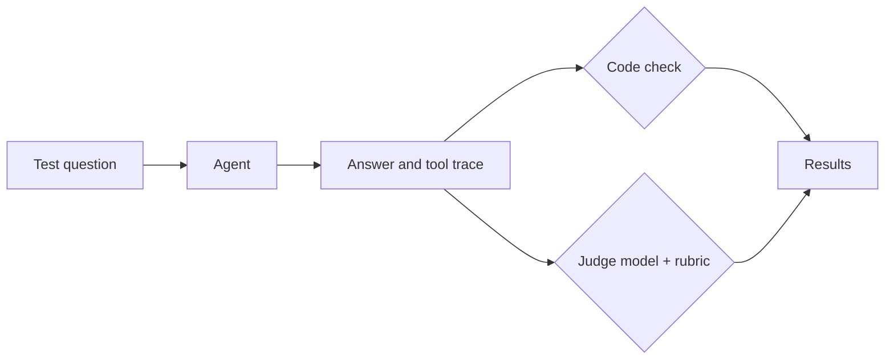

# Step 7. Building your own harness, and grading it with an LLM as a judge

## Why build your own

VS Code and Claude Code are harnesses made for one job: helping a developer in an editor. A product that uses an agent (a customer-service assistant, an internal tool that answers questions about your data) needs its own harness, running on a server, with your tools, your rules and your guardrails. Frameworks such as **LangChain** give you the pieces so you do not write the loop of step 1 by hand.

This step rebuilds the lab's agent in Python with LangChain, then measures how well it works.

## The pieces, in code

[harness.py](harness.py) is about 100 lines. Each piece of steps 1 to 6 becomes a few lines of it:

| Piece | In the IDE | In harness.py |
|---|---|---|
| Model | Chosen in the chat window | `ChatGoogleGenerativeAI(model="gemini-3.5-flash-lite")` |
| Agent loop (step 1) | Built in | `create_agent(...)`, from LangChain |
| Tools (step 2) | `.vscode/mcp.json`, `.mcp.json` | `load_mcp_tools`: starts the same two MCP servers; `MCPAdapter` (from `langchain.mcp`) wraps each tool as a LangChain tool |
| Instruction file (step 3) | `AGENTS.md`, read by the host | `system_prompt=Path("AGENTS.md").read_text()` |
| Guardrails (step 6) | Approval buttons, deny rules, hooks | **Middleware**: `ask_before_network` asks you before `get_public_ip` runs; `ModelCallLimitMiddleware` stops runaway loops |

**Middleware** is LangChain's name for code the harness runs around each model call or tool call. It plays the role of Claude Code's hooks: the model cannot skip it, because the model never runs it.

`create_agent` is built on **LangGraph**, LangChain's library for agents as graphs of steps. When you need more control than one loop (fixed steps, branches, several agents, a human approving midway) you write the graph yourself in LangGraph.

## Testing an agent

The same question can produce a different tool call or a different answer on the next run, and a small change to the prompt, a tool description or the model can break cases that used to work. Trying a question once by hand therefore proves little. Instead you keep a **test set** of questions with the behaviour you expect, and run it after every change, as you would run unit tests.

Some properties of an answer can be checked exactly in code: the reply is valid JSON, it contains a "Called ..." line for each tool, it is under 100 words. Others need reading: is the answer correct, is it grounded in the tool results, does it actually answer the question? People grade these well, but slowly and expensively, which makes grading the hardest part of testing an agent.

## LLM as a judge

An **LLM as a judge** is a second model call that grades the first model's output against written criteria. It is fast and cheap enough to run on every change, and handles the properties code cannot check.



What makes a judge reliable:

- **A rubric, not "is this good?".** Write explicit criteria, as you would for a human marker.
- **Evidence.** Give the judge the facts it needs to check, here the tool trace recorded by the harness. Without it, the judge cannot know the time in Tokyo either, and grades how plausible the answer sounds.
- **Pass or fail per case.** Models give inconsistent 1-to-10 scores; a binary verdict against clear criteria is far more stable.
- **Reasoning before the verdict.** Ask for the explanation first, so the verdict follows from it.
- **Structured output.** The judge returns a fixed schema (`Verdict` in [evaluate.py](evaluate.py)), so the program can count passes.
- **Code where code can.** A judge is itself a model and can be wrong. Use it only for what needs reading.

Known weaknesses: judges prefer longer answers, answers in their own style, and the first of two options when comparing; and they miss errors they would make themselves. Before trusting a judge, grade 20 or 30 cases by hand and measure how often it agrees with you. Use a different or stronger model than the agent's, so it does not share the agent's blind spots.

Judges are used in two places. **Offline**, as here, on a test set before you release a change. **Online**, as a guardrail on the output (step 6): every reply is graded before the user sees it, and failed replies are blocked or regenerated. Online judging adds a model call, so latency and cost, to every request.

## This step's files

- [harness.py](harness.py): the agent. Run it with a question.
- [evaluate.py](evaluate.py): a test set of five questions, a code check (does the answer list every tool it called, as `AGENTS.md` asks?) and a judge with a three-criterion rubric. It prints a verdict per case and saves everything to `results.json`.

## Setup

This step calls a model API, so you need a Gemini API key from Google AI Studio (<https://aistudio.google.com/apikey>). Create a file `.env` at the root of the repository (git ignores it) with the line:

```text
GEMINI_API_KEY=your-key-here
```

and pass it to every command with `--env-file .env`. In a codespace you can instead add the key as a Codespaces secret named `GEMINI_API_KEY` in your GitHub settings.

If a call fails with "model not found", the model was renamed or retired: change `MODEL` in harness.py or `JUDGE_MODEL` in evaluate.py to a current one from <https://ai.google.dev/gemini-api/docs/models>.

## Try it

1. **Run the agent.**

   ```bash
   uv run --env-file .env 07-own-harness/harness.py "What time is it in Tokyo right now?"
   ```

   The lines before the answer are the tool trace: each call the model asked for and the result the harness sent back. Does the answer follow the rules in `AGENTS.md`?
2. **The guardrail.** Ask *"What's my public IP?"* and answer `n` when the harness asks for approval. What does the model do with the refusal? Run it again and answer `y`.
3. **Evaluate.**

   ```bash
   uv run --env-file .env 07-own-harness/evaluate.py
   ```

   The evaluation approves every call itself, so the judge receives your public IP in the trace. Read each verdict and its reasoning. Do you agree with the judge on every case? Where the code check and the judge disagree, which one is right?
4. **Break the agent on purpose.** Delete the line about 24-hour format from `AGENTS.md`, run the evaluation again, and see which cases the judge now fails. Restore the line afterwards. This is how a test set catches a regression.

## Exercises

1. Add three test cases to `TEST_CASES`: one with two cities ("Is it later in Lima or in Madrid?"), one in Spanish, and one that should make the agent ask for clarification. Write the expected behaviour for each before you run them.
2. Grade the cases in `results.json` yourself, without looking at the judge's verdicts, then compare. How often do you agree? Change the rubric where you disagree and measure again.
3. Make the judge useless on purpose: remove the tool trace from `JUDGE_PROMPT`. Which wrong answers does it now let through? What does this tell you about judging without evidence?
4. Turn the judge into an online guardrail: in harness.py, after the agent answers, run the judge and, if the verdict fails, print "Answer withheld" and the reasoning instead of the answer. What does it add to the time and cost of each request?
5. Replace `ask_before_network` with LangChain's ready-made `HumanInTheLoopMiddleware` (see the middleware link below). What does the ready-made version need that yours does not?

## Further reading

- LangChain agents and `create_agent`: <https://docs.langchain.com/oss/python/langchain/agents>
- LangChain middleware: <https://docs.langchain.com/oss/python/langchain/middleware>
- LangGraph: <https://docs.langchain.com/oss/python/langgraph/overview>
- Zheng et al., "Judging LLM-as-a-Judge with MT-Bench and Chatbot Arena" (2023), the paper that measured judge biases: <https://arxiv.org/abs/2306.05685>
- Hamel Husain, "Creating a LLM-as-a-Judge that drives business results": <https://hamel.dev/blog/posts/llm-judge/>
